<p align="right">
  <a href="README.md"></a>
  <a href="README.zh-CN.md"></a>
</p>

<div align="center">


# Vibe Learn Anything

**Turn any topic into a real course — written by your AI, learned in a proper app.**

AI is a great teacher, but a chat log is not a syllabus. Your AI interviews you, writes a structured, interactive course,<br>
and you learn it with chapters, quizzes, code exercises, progress and notes — then send your questions straight back to it.

[](https://www.electronjs.org/) [](#-install) [](ai_manual/01-vla-format.md) [](LICENSE)

[](https://github.com/MrTangLuyao/vibe-learn-anything/releases) [](generate_course.md)

[**Install**](#-install) · [How it works](#how-it-works) · [Features](#features) · [For AI](#for-ai-the-course-format) · [FAQ](#faq) · [Docs](#documentation)

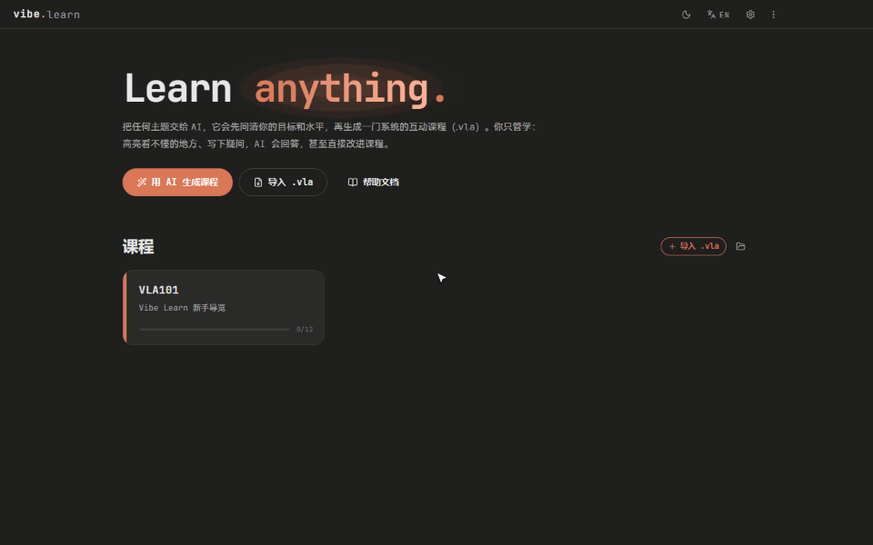 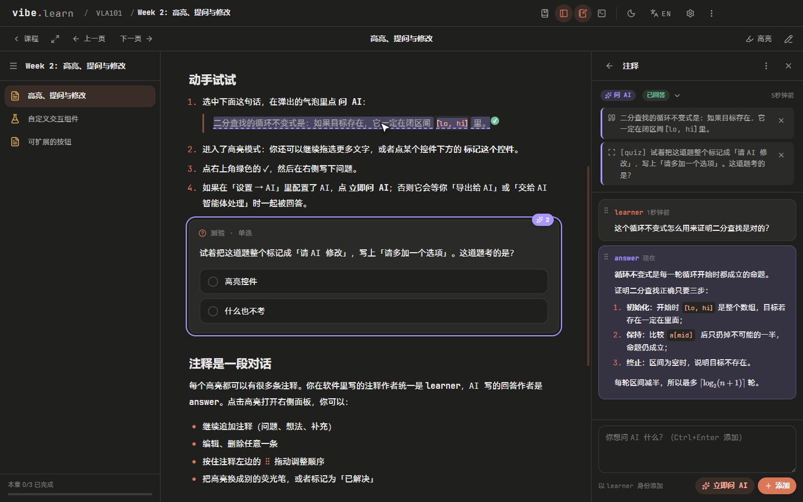

</div>

> [!NOTE]
> Vibe Learn Anything does not ship an AI. **Your AI writes the courses** (any agent that can read and write files works), and in-app answers use the endpoint or command-line agent you configure. Courses, notes and progress stay on your computer.

> [!TIP]
> On first launch the app imports **Vibe Learn Tour** — a ten-minute course that shows every feature. Then press **Generate with AI** and ask for anything you want to learn.

## Why

Asking an AI questions is easy; *learning a subject* from it is not. Answers scroll away, there is no structure, no practice and no memory of what you already know.

- **A real course, not a chat**: units → chapters → pages, like Ed or Canvas, with ✓ / ● / ○ progress and due dates.
- **Made for you**: before writing anything the AI asks about your goal, level, time and tools.
- **Practice built in**: quizzes, fill-in-the-blanks, code ordering, flashcards, and code exercises with a real terminal and tests.
- **Questions go back to the AI**: highlight anything — text, a quiz, a PDF page, your code — and *Ask AI* or *Ask AI to revise*. The AI answers you and improves the course.
- **Cheap to generate**: pages are short Markdown with interactive directives, not hand-written web pages, so the AI spends tokens on content.
- **Yours**: a course is one `.vla` file. Edit any page in the app, export it, share it, back it up.

## 📦 Install

1. Download the Windows installer from [**Releases**](https://github.com/MrTangLuyao/vibe-learn-anything/releases) and run it (macOS / Linux: build from source below).
2. Open the app. The tour course is already in your library.
3. Press **Generate with AI**: the app prepares an *AI workspace* (`Documents/VibeLearn`) with the instructions and tools your AI needs, and gives you a prompt to paste into your agent.

<details>
<summary><b>Run from source</b></summary>

Needs Node.js 18+.

```bash
npm install
npm start          # build and launch
npm run dist       # Windows installer → release/
```

| Command | What it does |
| --- | --- |
| `npm run dev` | development mode (Ctrl+R reloads) |
| `npm run watch` | rebuild the UI on change |
| `npm test` | unit tests (parser, packing, validation) |
| `npm run e2e` | drives the real app through the tour (invisible window), screenshots → `test-output/` |
| `npm run media` | re-records the GIFs and screenshots in this README |
| `npm run vla -- <cmd>` | the course tool (see below) |

</details>

## How it works

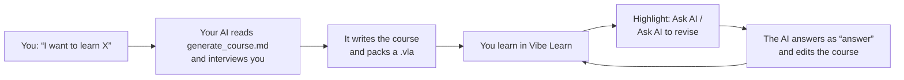

Two ways to close the loop:

| | Ask AI now | Hand notes to the AI |
| --- | --- | --- |
| How | an OpenAI-compatible endpoint you configure | your command-line agent, or any AI via an exported `.vla` |
| Good for | quick questions about what you are reading | answering everything at once and **rewriting the course** |
| Result | the answer streams into the note thread | the course folder is edited in place and refreshes |

## Features

### An AI tutor beside every page

The ✦ **AI** button in the title bar (Ctrl+Shift+A) opens a chat panel that always knows where you are: the page you are reading, the text you selected and the code in your workspace ride along as removable chips. One conversation per course, with follow-ups.

- **Uses your own Claude Code** — the command-line version, or the copy that ships with the Claude desktop app (Microsoft Store build included). No extra endpoint or API key; sign in once from Settings.
- **Changes the course live**: switch on *Allow changes* and ask "add a real-life example at the end of this page" — the page re-renders while it works, and every turn has an **Undo**.
- **AI edit** in the lesson bar, and an **AI** button in every code workspace (explain the code, hints-only debugging, change the exercise, mark it for the AI); *Ask AI* is in the editor's right-click menu too.
- **MCP server built in** (`vibe-learn`): the AI sees the page you have open, reads and edits pages, answers your notes and validates the course. It is attached automatically, and Settings adds it to Claude Code or the Claude desktop app in one click.
- Prefer something else? An OpenAI-compatible endpoint or any command-line agent still works for answers.

### Highlight anything, ask the AI

Select text and pick a highlighter: four colours for your own notes, **Ask AI** and **Ask AI to revise** for the AI. In highlight mode you can drag over many passages and mark whole controls (a quiz, a code editor, a PDF), then press ✓. Every highlight is a thread: your notes are written as `learner`, the AI's replies as `answer`; add, edit, delete, and drag the grip to reorder.

<div align="center">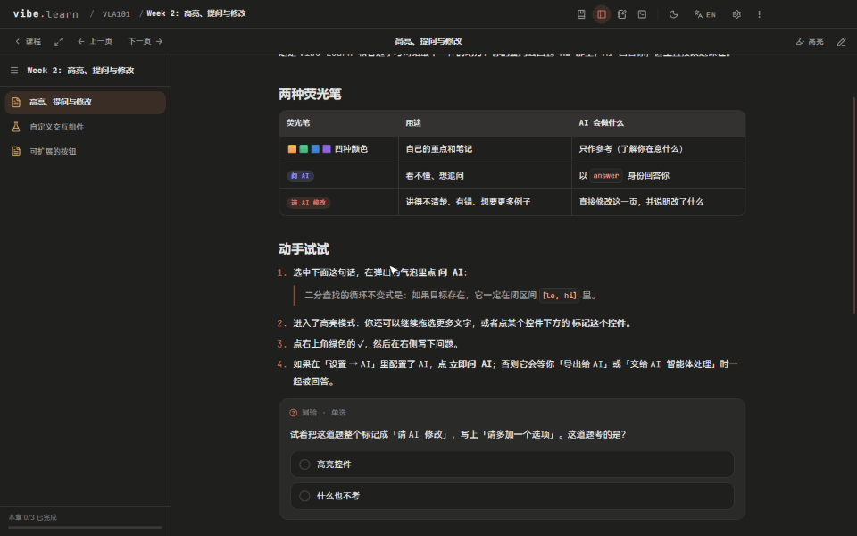</div>

### Code exercises with a real terminal

An Ed-style workspace: file tabs in the VS Code editor (Monaco), a real pseudo-terminal (xterm.js + node-pty), **Run**, **Submit** with tests and hidden tests, hints and a reference solution. Node.js is built in, so JavaScript always runs; C, C++, Python, Java, Go, Rust, SQL and more use the tools on your computer.

<div align="center">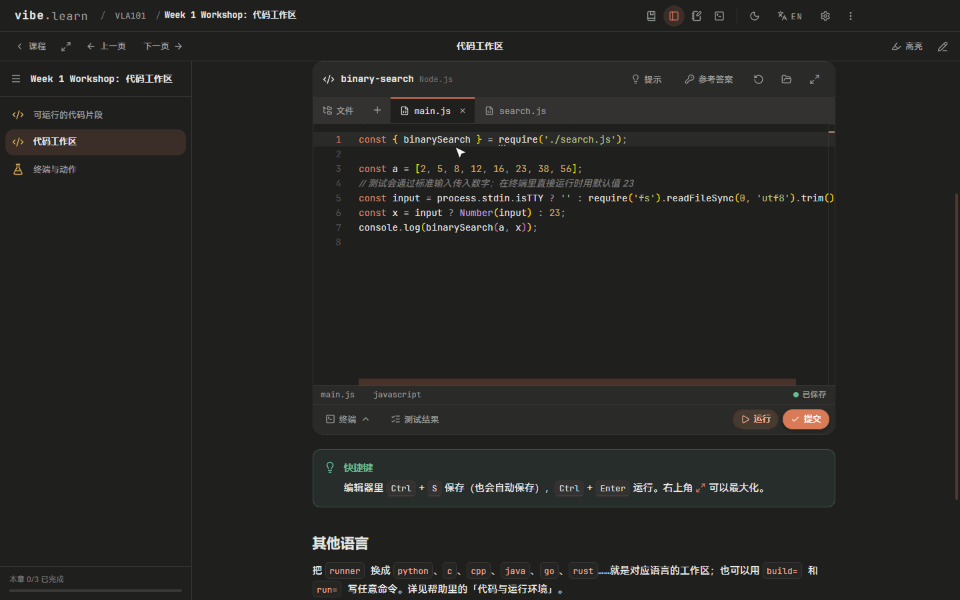</div>

### Practise and remember

Single and multiple choice, short answers, numbers, surveys, open questions with AI feedback, fill-in-the-blanks, drag-to-order code (Parsons problems), flashcards, step-by-step reveals and slide decks. Pages with quizzes or tests complete when you pass them; others when you mark them. Right-click a page in the list to mark it done or not done, reset its progress, or delete it; ↺ on a quiz starts it over.

<div align="center">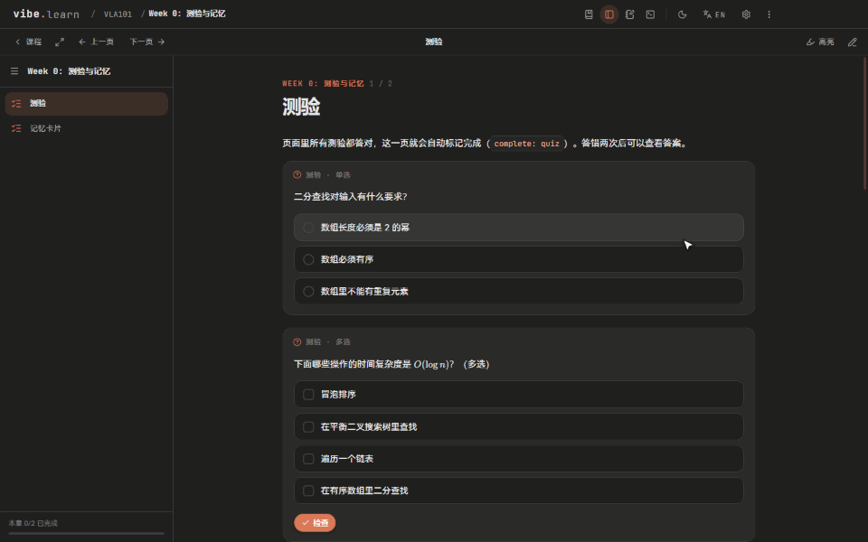</div>

### Let your AI agent revise the course

With a command-line agent configured, **AI → Let the AI agent handle notes** runs it inside the course folder: it answers every *Ask AI*, rewrites what you marked *Ask AI to revise*, and the course refreshes. Without one, **Export for the AI** gives you a `.vla` plus a ready prompt for any AI; the new version is offered for import automatically and your notes are merged.

<div align="center">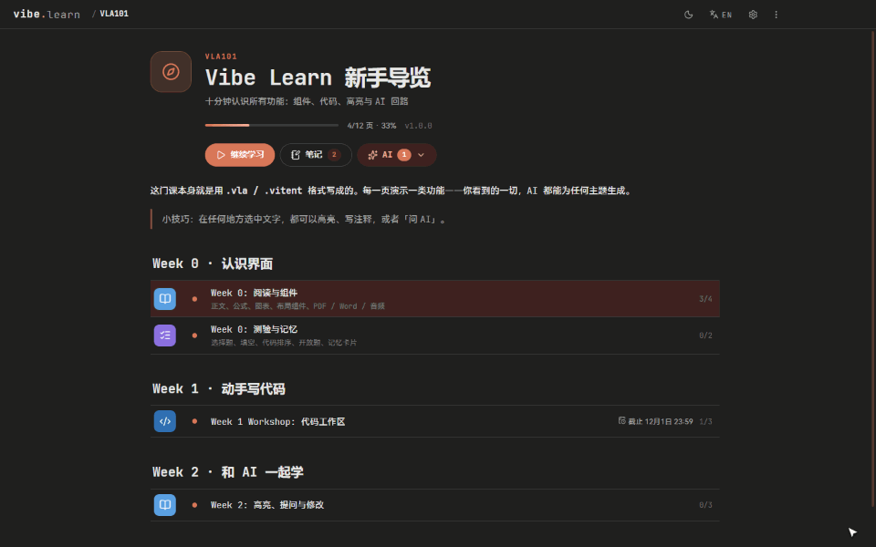</div>

### Edit any page in the app

Press ✎ and type straight into the page, like Typora: paragraphs, headings, lists, tables and callouts are editable and saved as you go, while controls (quizzes, code, PDFs, slides) stay locked. Turn on *Source editing* in Settings for the split Vitent Markdown editor with live preview and syntax checking.

Pages can also go **full screen**: a page made of a single `:::fullscreen` block (a code workspace, PDF, slides, a web lab…) fills the whole reading area.

<div align="center">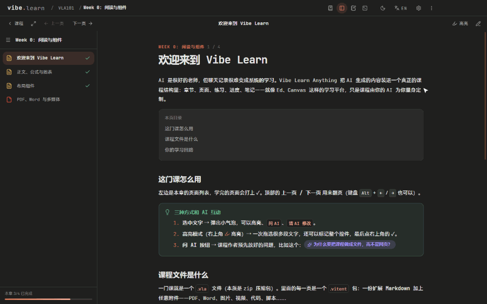</div>

### Everything else

<table>
  <tr>
    <td align="center">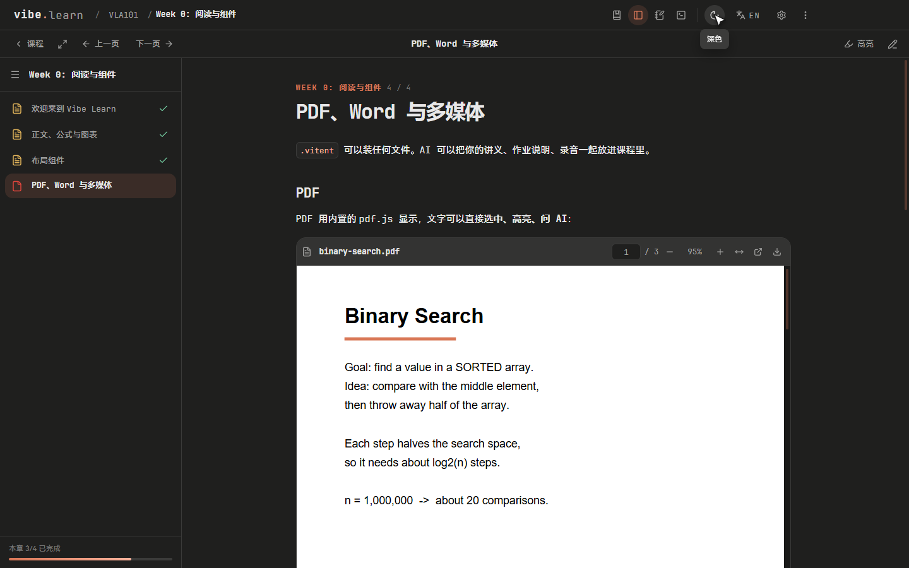<br><sub>PDFs with a text layer — highlight inside them</sub></td>
    <td align="center">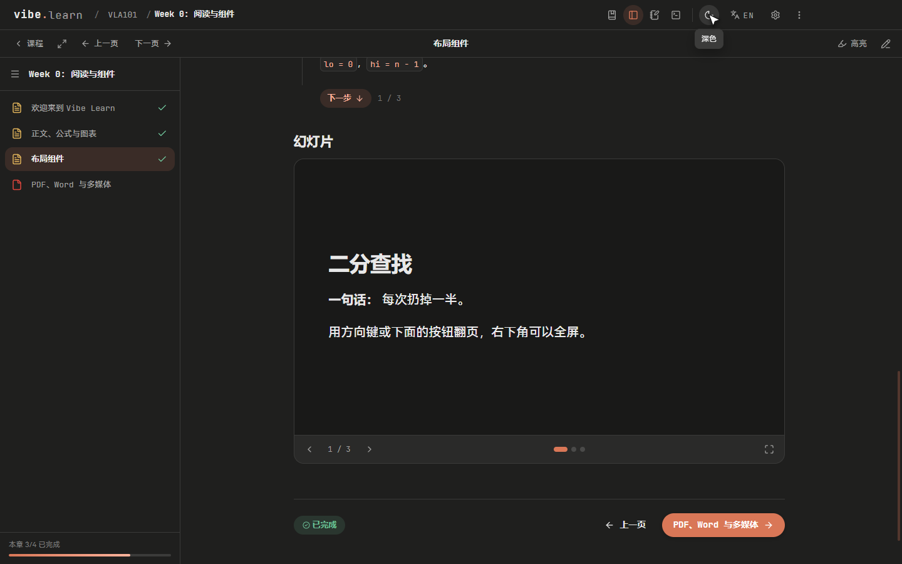<br><sub>Slides, tabs, columns, steps, callouts, KaTeX, Mermaid</sub></td>
  </tr>
  <tr>
    <td align="center">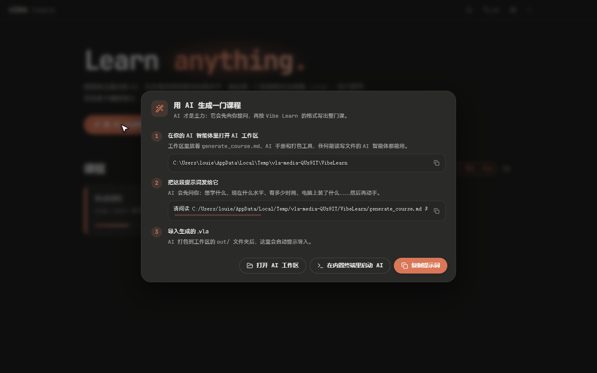<br><sub>Generate a course: the AI workspace and the prompt</sub></td>
    <td align="center">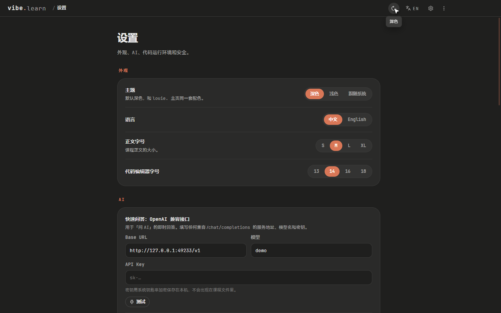<br><sub>Settings: themes, AI endpoint & agent, runtimes, trust</sub></td>
  </tr>
</table>

- **Any file in a page**: PDF, Word (rendered as text), images, audio, video (YouTube / bilibili links too), attachments, embedded sites.
- **Custom interactive widgets**: when built-ins are not enough the AI can write a small HTML widget; it runs sandboxed and talks to the app through `vla://_/bridge.js` (state, completion, actions, Ask AI, theme colours).
- **Extensible buttons**: courses add, replace or hide buttons in the title bar, lesson bar, sidebar and page end — priority built-in < `course.json` < page.
- **Actions**: run a command, a script inside the page, call a backend over HTTP, open files, ask the AI, drive the UI.
- **Dark and light themes, English and Chinese UI**, ripple feedback on everything, the louie. palette and JetBrains Mono.

<div align="center">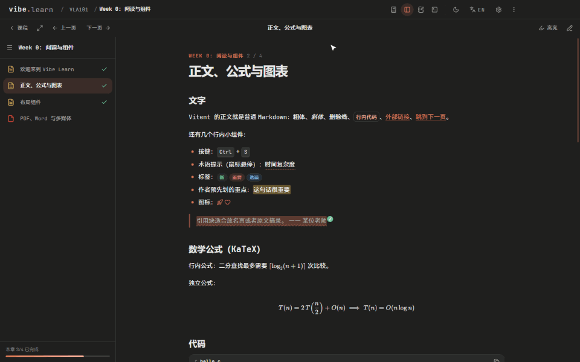</div>

## For AI: the course format

The specification is written for AI agents: [`AGENTS.md`](AGENTS.md) → [`generate_course.md`](generate_course.md) → [`ai_manual/`](ai_manual/).

A **`.vla`** is a zip with `course.json` (units, chapters, pages, buttons, actions) and pages. Each page is a **`.vitent`** package: `index.md` in *Vitent Markdown* plus any files.

````markdown
---
title: Binary search
kind: code
---

Halve the search space each step: $O(\log n)$.

:::quiz{id="q-sorted"}
What does binary search need?
- [ ] A power-of-two length
- [x] A sorted array
::::explain
Each comparison throws away half — that only works when the data is ordered.
::::
:::

:::workspace{id="ws-bs" runner="node" main="main.js"}
```js file=main.js
// TODO: implement binarySearch
```
::::tests
```yaml
- { name: finds 16, stdin: "16", expect: "4" }
```
::::
:::
````

```bash
node tools/vla.mjs new courses/demo --title "Demo" --id demo
node tools/vla.mjs validate courses/demo      # every directive, asset and action is checked
node tools/vla.mjs pack courses/demo -o out/demo.vla
node tools/vla.mjs notes courses/demo         # highlights waiting for the AI
```

## FAQ

<details>
<summary><b>Which AI do I need?</b></summary>

Any agent that can read and write files can generate courses — point it at the AI workspace and paste the prompt. For in-app answers, add an OpenAI-compatible endpoint (base URL, model, key) or a command-line agent in **Settings → AI**. Keys are encrypted with the system keychain and never written into course files.
</details>

<details>
<summary><b>Is running code from a course safe?</b></summary>

The first time a course wants to run a command, call the network or start a terminal command, the app asks you with a system dialog: trust the course, allow just once, or cancel. Trust can be revoked in Settings. The UI runs with context isolation and sandboxing, course HTML is sanitised, and custom widgets run in sandboxed iframes on a separate origin.
</details>

<details>
<summary><b>My language / compiler is not installed.</b></summary>

Node.js is built into the app, so JavaScript and TypeScript exercises always run. Other tools are detected automatically; a course can list what it needs (`requirements`) and the course page shows install hints for anything missing.
</details>

<details>
<summary><b>What happens to my notes when the AI sends a new version?</b></summary>

Courses are matched by `id`. Importing a newer version replaces the content but keeps your progress and code, and merges highlights and comments by id.
</details>

<details>
<summary><b>Can I write courses by hand?</b></summary>

Yes — it is just Markdown with directives. Use the in-app editor or any text editor, then `node tools/vla.mjs pack`.
</details>

## Documentation

- [User guide](docs/user-guide.md) (中文)
- [Generating courses](generate_course.md) · [AGENTS.md](AGENTS.md)
- AI manual: [01 `.vla`](ai_manual/01-vla-format.md) · [02 `.vitent`](ai_manual/02-vitent-format.md) · [03 components](ai_manual/03-vitent-blocks.md) · [04 actions & buttons](ai_manual/04-actions-buttons.md) · [05 highlights & the AI loop](ai_manual/05-annotations.md) · [06 code & runtimes](ai_manual/06-code-and-runtimes.md) · [07 open-source parts](ai_manual/07-components.md)

<details>
<summary><b>Project layout</b></summary>

```text
src/main/       Electron main process: window, app:// and vla:// protocols, library, commands & terminals, AI, AI workspace
src/shared/     shared with the CLI: Vitent parser, directive registry & validation, .vla packing, runners
src/renderer/   the UI (plain JS + esbuild): views, Vitent renderer & widgets, highlights, styles, widget bridge
tools/          build.mjs · vla.mjs (course tool) · record-media.mjs (README media)
ai_manual/      the format manual for AI agents
examples/       the tour course source
test/           unit tests, end-to-end driver, a fake AI agent
```
</details>

## Credits

Built on Electron, Monaco Editor, xterm.js, node-pty, pdf.js, KaTeX, Mermaid, markdown-it, highlight.js, mammoth.js, DOMPurify, SortableJS, Lucide, fflate and js-yaml — each under its own license. Design and fonts from the louie. homepage (JetBrains Mono, OFL-1.1).

## License

[MIT](LICENSE)
