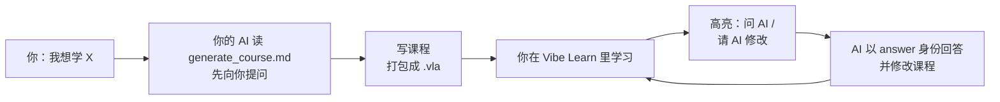

<p align="right">
  <a href="README.md"></a>
  <a href="README.zh-CN.md"></a>
</p>

<div align="center">


# Vibe Learn Anything

**让 AI 把任何主题写成一门真正的课程，然后在一个像样的软件里系统地学。**

AI 是很好的老师，但聊天记录不是课程大纲。你的 AI 先向你提问，再写出一门结构化的互动课程；<br>
你在章节、测验、代码练习、进度和笔记里学习，看不懂的地方一键交回给 AI。

[](https://www.electronjs.org/) [](#-安装) [](ai_manual/01-vla-format.md) [](LICENSE)

[](https://github.com/MrTangLuyao/vibe-learn-anything/releases) [](generate_course.md)

[**安装**](#-安装) · [工作原理](#工作原理) · [功能](#功能) · [给 AI 的格式](#给-ai课程格式) · [常见问题](#常见问题) · [文档](#文档)

 

</div>

> [!NOTE]
> Vibe Learn Anything 本身不带 AI。**课程由你的 AI 来写**（任何能读写文件的 AI 智能体都可以），软件里的即时回答使用你自己配置的接口或命令行智能体。课程、笔记和进度都只保存在你的电脑上。

> [!TIP]
> 第一次打开会自动导入 **Vibe Learn 新手导览**：十分钟看完所有功能。然后点 **用 AI 生成课程**，想学什么就让 AI 做什么。

## 为什么需要它

向 AI 提问很容易，*跟着 AI 系统地学会一门东西*却很难：回答一刷就过去了，没有结构、没有练习、也不记得你已经会了什么。

- **真正的课程，而不是聊天**：单元 → 章节 → 页面，像 Ed / Canvas 一样有 ✓ / ● / ○ 进度和截止日期。
- **为你定制**：动笔之前，AI 会先问你的目标、基础、时间和电脑上的工具。
- **练习内置**：测验、完形填空、代码排序、记忆卡片，以及带真终端和自动测试的代码题。
- **疑问回到 AI**：高亮任何东西——文字、一道题、PDF 的某一页、你的代码——选「问 AI」或「请 AI 修改」。AI 回答你，并改进课程本身。
- **生成成本低**：页面是带交互指令的简短 Markdown，不是手写网页，AI 的 token 花在内容上。
- **属于你**：一门课就是一个 `.vla` 文件。在软件里编辑任何一页，导出、分享、备份都行。

## 📦 安装

1. 在 [**Releases**](https://github.com/MrTangLuyao/vibe-learn-anything/releases) 下载 Windows 安装包并运行（macOS / Linux 请用下面的源码方式）。
2. 打开软件，示例课程已经在课程列表里。
3. 点 **用 AI 生成课程**：软件会准备好「AI 工作区」（`文档/VibeLearn`），里面有 AI 需要的说明和工具，并给你一段提示词，粘贴给你的 AI 智能体即可。

<details>
<summary><b>从源码运行</b></summary>

需要 Node.js 18+。

```bash
npm install
npm start          # 构建并启动
npm run dist       # 打包 Windows 安装程序 → release/
```

| 命令 | 作用 |
| --- | --- |
| `npm run dev` | 开发模式（Ctrl+R 重新加载） |
| `npm run watch` | 修改界面代码后自动重新构建 |
| `npm test` | 单元测试（解析器、打包、校验） |
| `npm run e2e` | 用不可见窗口驱动真实软件走一遍示例课程，截图在 `test-output/` |
| `npm run media` | 重新录制本 README 的 GIF 和截图 |
| `npm run vla -- <命令>` | 课程命令行工具（见下文） |

</details>

## 工作原理



两种方式把问题交给 AI：

| | 立即问 AI | 交给 AI 处理笔记 |
| --- | --- | --- |
| 方式 | 你配置的 OpenAI 兼容接口 | 你的命令行智能体，或把 `.vla` 导出给任何 AI |
| 适合 | 正在读的内容马上有疑问 | 一次性回答所有问题，并**改写课程** |
| 结果 | 回答流式写进注释对话 | 课程文件夹被直接修改，软件自动刷新 |

## 功能

### 高亮任何东西，问 AI

选中文字后选择荧光笔：四种颜色记自己的笔记，**问 AI** 和 **请 AI 修改** 交给 AI。高亮模式里可以一次拖选多段文字，还能标记整个控件（一道题、代码编辑器、PDF），最后点右上角 ✓。每个高亮都是一段对话：你写的注释作者是 `learner`，AI 的回答作者是 `answer`；可以追加、编辑、删除，按住左侧手柄拖动排序。

<div align="center"></div>

### 带真终端的代码练习

仿 Ed 的代码工作区：VS Code 同款编辑器（Monaco）多标签编辑、真正的伪终端（xterm.js + node-pty）、**运行**、带测试和隐藏测试的 **提交**、提示和参考答案。软件内置 Node.js，JavaScript 永远能跑；C、C++、Python、Java、Go、Rust、SQL 等使用你电脑上的工具。

<div align="center"></div>

### 练习与记忆

单选、多选、填空、数值题、问卷、可以请 AI 点评的开放题、完形填空、拖动排序代码（Parsons）、记忆卡片、分步揭示和幻灯片。学完、答对或测试通过后页面自动标记完成。

<div align="center"></div>

### 让 AI 智能体改进课程

设置了命令行智能体后，**AI → 交给 AI 智能体处理标注** 会让它在课程文件夹里工作：回答每一个「问 AI」，改写你标为「请 AI 修改」的地方，完成后课程自动刷新。没有智能体也没关系：**导出给 AI** 会生成 `.vla` 和一段现成的提示词，发给任何 AI；新版本打包回来时软件自动提示导入，你的笔记会合并保留。

<div align="center"></div>

### 在软件里编辑任何一页

每一页的文字都是 Vitent Markdown。点 ✎ 打开编辑器，右边实时预览，语法错误会标出来。

<div align="center"></div>

### 其他

<table>
  <tr>
    <td align="center"><br><sub>PDF 带文字层——可以在里面高亮</sub></td>
    <td align="center"><br><sub>幻灯片、标签页、分栏、分步、提示框、KaTeX、Mermaid</sub></td>
  </tr>
  <tr>
    <td align="center"><br><sub>生成课程：AI 工作区和提示词</sub></td>
    <td align="center"><br><sub>设置：主题、AI 接口与智能体、运行环境、信任</sub></td>
  </tr>
</table>

- **页面里可以放任何文件**：PDF、Word（转换成可高亮的正文）、图片、音频、视频（也支持 YouTube / bilibili 链接）、附件、网页嵌入。
- **自定义交互组件**：内置组件不够用时，AI 可以写一个小 HTML 组件，在沙箱里运行，通过 `vla://_/bridge.js` 和软件通信（状态、完成、动作、问 AI、主题配色）。
- **可扩展的按钮**：课程可以在顶栏、课程栏、侧栏、页尾添加、替换或隐藏按钮——优先级 内置 < `course.json` < 页面。
- **动作**：执行命令、运行页面里的脚本、通过 HTTP 调用后端、打开文件、问 AI、操作界面。
- **深色 / 浅色主题、中英文界面**，所有按钮和卡片都有涟漪反馈，louie. 的配色和 JetBrains Mono 字体。

<div align="center"></div>

## 给 AI：课程格式

规范是写给 AI 智能体看的：[`AGENTS.md`](AGENTS.md) → [`generate_course.md`](generate_course.md) → [`ai_manual/`](ai_manual/)。

**`.vla`** 是一个 zip：`course.json`（单元、章节、页面、按钮、动作）加上页面。每一页是一个 **`.vitent`** 包：用 *Vitent Markdown* 写的 `index.md`，加上任意文件。

````markdown
---
title: 二分查找
kind: code
---

每一步把搜索区间减半：$O(\log n)$。

:::quiz{id="q-sorted"}
二分查找对数组有什么要求？
- [ ] 长度必须是 2 的幂
- [x] 必须有序
::::explain
每次比较都要扔掉一半——只有有序时才成立。
::::
:::

:::workspace{id="ws-bs" runner="node" main="main.js"}
```js file=main.js
// TODO: 实现 binarySearch
```
::::tests
```yaml
- { name: 找到 16, stdin: "16", expect: "4" }
```
::::
:::
````

```bash
node tools/vla.mjs new courses/demo --title "演示" --id demo
node tools/vla.mjs validate courses/demo      # 检查每一个指令、资源和动作
node tools/vla.mjs pack courses/demo -o out/demo.vla
node tools/vla.mjs notes courses/demo         # 列出等待 AI 处理的高亮
```

## 常见问题

<details>
<summary><b>需要什么 AI？</b></summary>

任何能读写文件的 AI 智能体都能生成课程——让它打开 AI 工作区，粘贴提示词即可。软件里的即时回答需要在 **设置 → AI** 填写 OpenAI 兼容接口（地址、模型、密钥）或命令行智能体。密钥用系统钥匙串加密保存在本机，不会写进课程文件。
</details>

<details>
<summary><b>运行课程里的代码安全吗？</b></summary>

课程第一次要运行命令、访问网络或在终端里执行命令时，软件会弹出系统对话框：信任此课程、仅这一次、或取消。信任可以在设置里撤销。界面开启了上下文隔离和沙箱，课程里的 HTML 会被清洗，自定义组件运行在不同源的沙箱 iframe 里。
</details>

<details>
<summary><b>我没装对应的语言 / 编译器怎么办？</b></summary>

软件内置 Node.js，JavaScript 和 TypeScript 练习总能运行。其他工具会自动检测；课程可以在 `requirements` 里写明需要什么，缺少时课程页会显示安装提示。
</details>

<details>
<summary><b>AI 发来新版本后，我的笔记会怎样？</b></summary>

课程按 `id` 对应。导入新版本会替换课程内容，但保留你的进度和代码，高亮和注释按 id 合并。
</details>

<details>
<summary><b>可以自己手写课程吗？</b></summary>

可以，就是带指令的 Markdown。用软件里的编辑器或任何文本编辑器写，然后 `node tools/vla.mjs pack` 打包。
</details>

## 文档

- [使用指南](docs/user-guide.md)
- [生成课程](generate_course.md) · [AGENTS.md](AGENTS.md)
- AI 手册：[01 `.vla`](ai_manual/01-vla-format.md) · [02 `.vitent`](ai_manual/02-vitent-format.md) · [03 组件大全](ai_manual/03-vitent-blocks.md) · [04 动作与按钮](ai_manual/04-actions-buttons.md) · [05 高亮与 AI 回路](ai_manual/05-annotations.md) · [06 代码与运行环境](ai_manual/06-code-and-runtimes.md) · [07 开源组件](ai_manual/07-components.md)

<details>
<summary><b>项目结构</b></summary>

```text
src/main/       Electron 主进程：窗口、app:// 与 vla:// 协议、课程库、命令与终端、AI、AI 工作区
src/shared/     与命令行工具共用：Vitent 解析器、指令注册表与校验、.vla 打包、运行器
src/renderer/   界面（原生 JS + esbuild）：视图、Vitent 渲染器与组件、高亮、样式、组件桥接
tools/          build.mjs · vla.mjs（课程工具）· record-media.mjs（README 素材）
ai_manual/      给 AI 智能体的格式手册
examples/       示例课程源文件
test/           单元测试、端到端驱动、模拟 AI 智能体
```
</details>

## 致谢

基于 Electron、Monaco Editor、xterm.js、node-pty、pdf.js、KaTeX、Mermaid、markdown-it、highlight.js、mammoth.js、DOMPurify、SortableJS、Lucide、fflate、js-yaml 构建，各组件遵循各自的许可证。设计与字体来自 louie. 主页（JetBrains Mono, OFL-1.1）。

## 许可证

[MIT](LICENSE)
