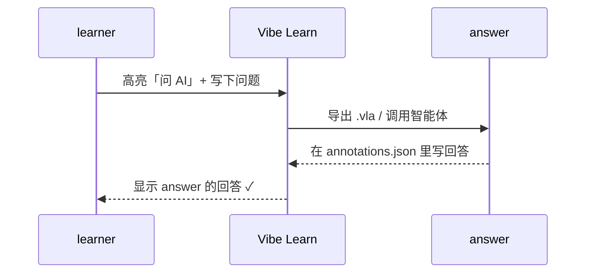

## 文字

Vitent 的正文就是普通 Markdown：**粗体**、*斜体*、~~删除线~~、`行内代码`、[外部链接](https://www.wikipedia.org)、[跳到下一页](../layout.vitent)。

还有几个行内小组件：
- 按键：:kbd[Ctrl] + :kbd[S]
- 术语提示（鼠标悬停）：:term[时间复杂度]{tip="算法运行时间随输入规模增长的速度，常用大 O 表示"}
- 标签：:badge[新]{color="ok"} :badge[重要]{color="err"} :badge[选读]{color="info"}
- 作者预先划的重点：:hl[这句话很重要]{color="yellow"}
- 图标：:icon[rocket] :icon[heart]{color="#e0645c"}

> 引用块适合放名言或者原文摘录。
> —— 某位老师

## 数学公式（KaTeX）

行内公式：二分查找最多需要 $\lceil \log_2 (n+1) \rceil$ 次比较。

独立公式：

$$
T(n) = 2\,T\!\left(\frac{n}{2}\right) + O(n) \;\Longrightarrow\; T(n) = O(n \log n)
$$

## 代码

```c {title="hello.c"}
#include <stdio.h>
#include <stdlib.h>

int main(int argc, char **argv) {
    printf("Hello, world!\n");
    return EXIT_SUCCESS;   // same as "return 0"
}
```

高亮其中几行（`lines="3-5"`）：

```python {lines="3-5"}
def binary_search(a, x):
    lo, hi = 0, len(a) - 1
    while lo <= hi:
        mid = (lo + hi) // 2
        if a[mid] == x: return mid
        if a[mid] < x: lo = mid + 1
        else: hi = mid - 1
    return -1
```

## 图表（Mermaid）



## 表格

| 操作 | 数组 | 链表 |
| --- | :---: | :---: |
| 按下标访问 | $O(1)$ | $O(n)$ |
| 头部插入 | $O(n)$ | $O(1)$ |
| 查找 | $O(n)$ | $O(n)$ |
