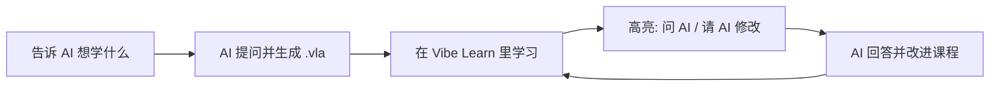

AI 是很好的老师，但聊天记录很难变成**系统的学习**。Vibe Learn Anything 把 AI 生成的内容装进一个真正的课程结构里：章节、页面、练习、进度、笔记——就像 Ed、Canvas 这样的学习平台，只是课程由你的 AI 为你量身定制。

::toc

## 这门课怎么用

左边是本章的页面列表，学完的页面会打上 ✓。顶部的 **上一页 / 下一页** 用来翻页（键盘 :kbd[Alt] + :kbd[←] / :kbd[→] 也可以）。

:::tip[三种方式和 AI 互动]
1. **选中文字** → 弹出小气泡，可以高亮、`问 AI`、`请 AI 修改`。
2. **高亮模式**（右上角 :icon[highlighter] 高亮）→ 一次拖选很多段文字，还可以标记整个控件，最后点右上角的 ✓。
3. **问 AI 按钮** → 课程作者预先放好的问题，比如这个：:ask[为什么要把课程做成文件，而不是网页？]
:::

## 课程文件是什么

一门课就是一个 `.vla` 文件（本质是 zip 压缩包）。里面的每一页是一个 `.vitent` 包：一份**扩展 Markdown** 加上任意附件——PDF、Word、图片、视频、代码、脚本……

| 文件 | 作用 |
| --- | --- |
| `course.json` | 课程信息、章节结构、全局按钮和动作 |
| `content/**/*.vitent` | 每一页的内容（`index.md` + 资源） |
| `annotations.json` | 你的高亮和注释，以及 AI 的回答 |
| `learner/` | 你的进度、测验记录和写过的代码 |

:::note[为什么不直接生成网页？]
让 AI 写完整的网页非常费 token，也很难保证风格统一。`.vitent` 只需要写 Markdown 和几十种简短的组件指令（比如 `:::quiz`、`:::workspace`），渲染、交互、样式都由软件负责。AI 把精力花在**内容**上。
:::

## 你的学习回路

准备好了吗？点下一页，看看正文能写成什么样。
